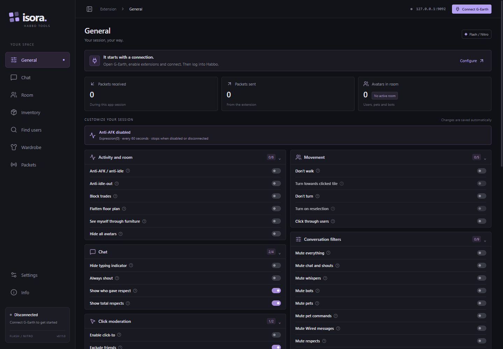

# Isora

A compact desktop companion for **Habbo Flash/Nitro**, built with Electron and Electron Forge. Connect it to G-Earth to customize your session and explore what is happening in your room.



## Features

- Session controls, anti-AFK, movement options and chat filters.
- Live chat log with search, export and automatic scrolling.
- Room users and visitors, profile actions and local profile search history.
- Furniture names, search and a temporary local highlight to help you find an item.
- Saved outfits and an inventory viewer.
- Packet viewer, message map and packet composer.
- English and Spanish, with a layout that adapts to smaller windows.

## Getting started

1. Download the Windows installer or portable ZIP from this repository's **Releases**. Extract the entire ZIP before opening `Isora.exe`.
2. Open G-Earth and enable extension connections (usually port **9092**).
3. Open Isora and click **Connect G-Earth**. Change the port in **Settings** if needed.
4. Connect Habbo through G-Earth, then enter or re-enter a room to load its users and furniture.

G-Earth and the Habbo client run separately. Features require the corresponding message names to be identified by G-Earth. Flash/Nitro is supported; Origins/Shockwave and Unity are not supported.

## Two ways to run

**Standalone:** use the Windows installer or regular portable ZIP, open `Isora.exe`, and click **Connect G-Earth**. Disconnecting leaves Isora open.

**From G-Earth (manual):** close both apps and manually prepare the `Isora` folder using the descriptor and launcher in `gearth/`, together with all files from the portable app. Copy the complete `Isora` folder into G-Earth's active `Extensions` directory. Keep the folder name. Start G-Earth; it reads `Isora/command.txt`, supplies its port and authentication arguments, and keeps Isora in the background. **Play** opens the window. Closing the window hides it while features keep running. Stopping Isora from G-Earth exits the process and leaves its **Restart** and **Remove** controls available.

```text
Extensions/
  Isora/
    command.txt
    README.txt
    extension/
      Isora.cmd
      Isora.exe
      resources/
      ...other Electron files
```

After upgrading, restart G-Earth once so it recreates the extension row with the updated Restart/Remove permissions.

The manual folder layout is not a single EXE for G-Earth's file picker or a public store listing. Do not copy only `Isora.exe`. To update, close both apps and manually replace the `Isora` folder. The same `extension/Isora.exe` can also run standalone. Nothing in Isora installs or updates files inside G-Earth automatically.

## Language

**Settings → Language** offers **Automatic by hotel**, **Spanish** and **English**. Automatic uses Spanish on `game-es.habbo.com` and English on other hotels or while disconnected. A manual choice is saved and takes priority when you change hotels.

Settings, outfits and searched profiles are saved locally. Visitors are kept only for the current room and cleared when you change rooms, leave or disconnect.

Translations live in separate files: `src/locales/en.json` and `src/locales/es.json`. Both use the same English message keys, such as `navigation.room`. Add or edit text in the corresponding language file; keep keys and placeholders identical in both files.

## Development

Requires **Node.js 22.13+**, npm and Windows for the Windows builds.

```sh
npm ci
npm start
```

```sh
npm run typecheck
npm run lint
npm test
npm run make
```

Builds are written to `out/make/`. Only the standalone installer and portable ZIP are built; no G-Earth-specific ZIP is generated. After packaging, run `npm run test:ui`, `npm run test:package` and `npm run test:extension` / `npm run test:extension-ui` for Electron checks. Run `npm run screenshot` to refresh the English screenshot with an isolated app profile.

## License

MIT. See [LICENSE](LICENSE) for attribution and third-party license notices. Isora is independent and is not affiliated with Habbo or Sulake. Windows binaries are unsigned; game integration can vary by client version.
